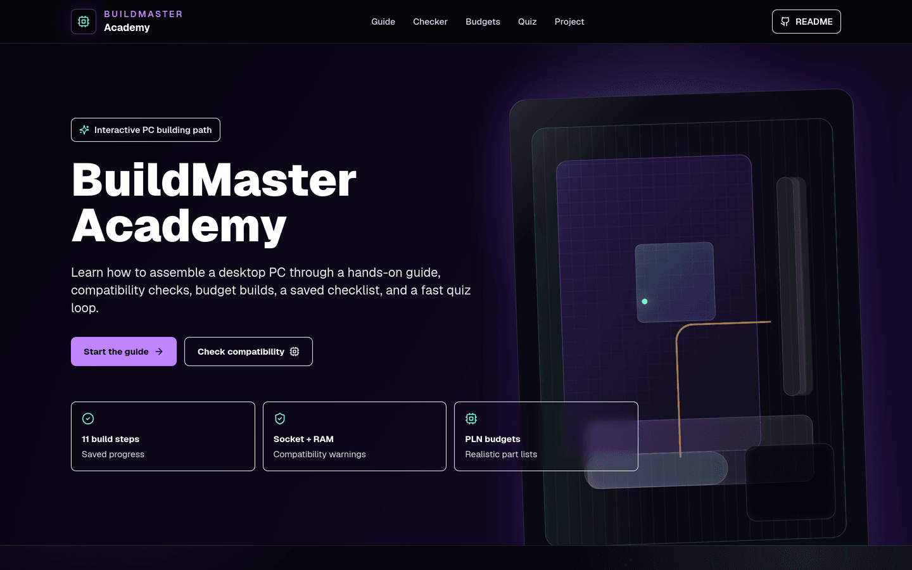
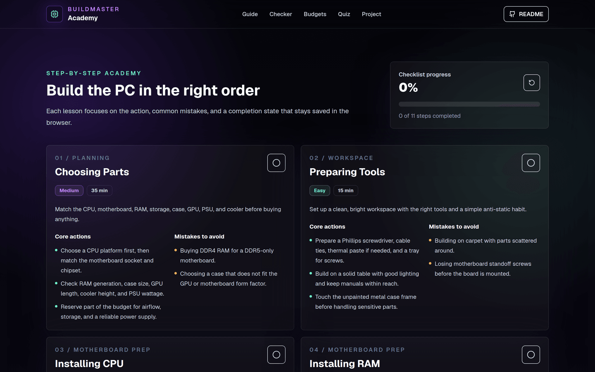
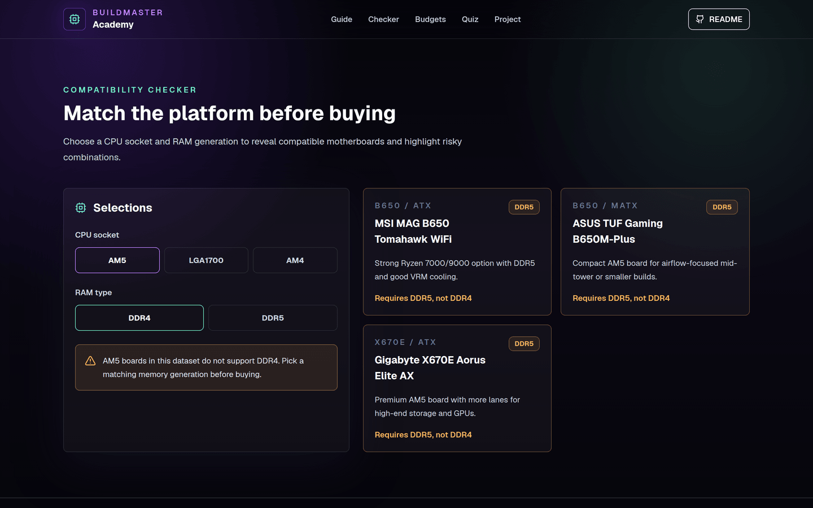
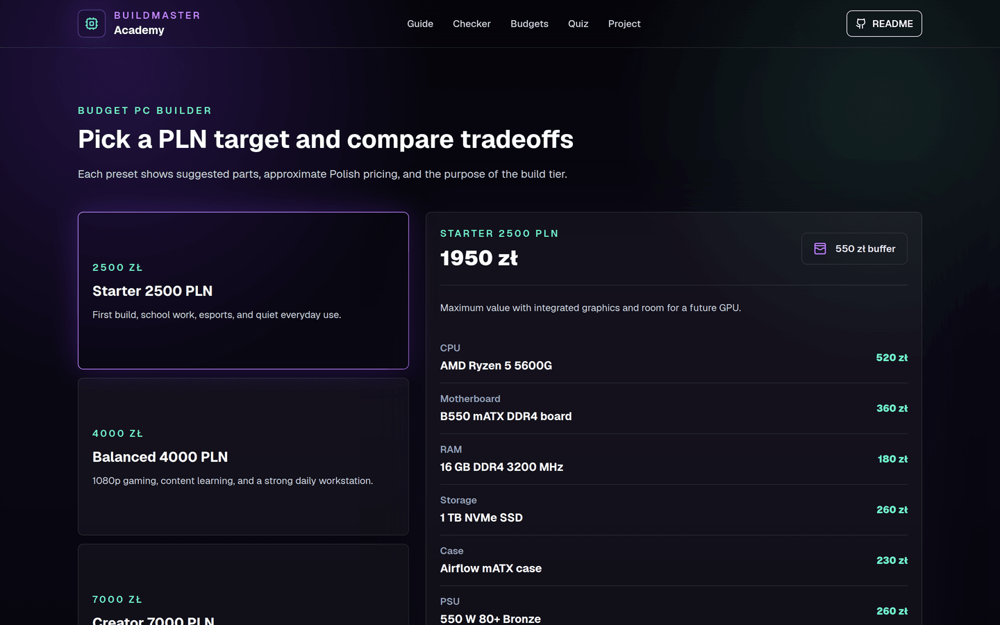
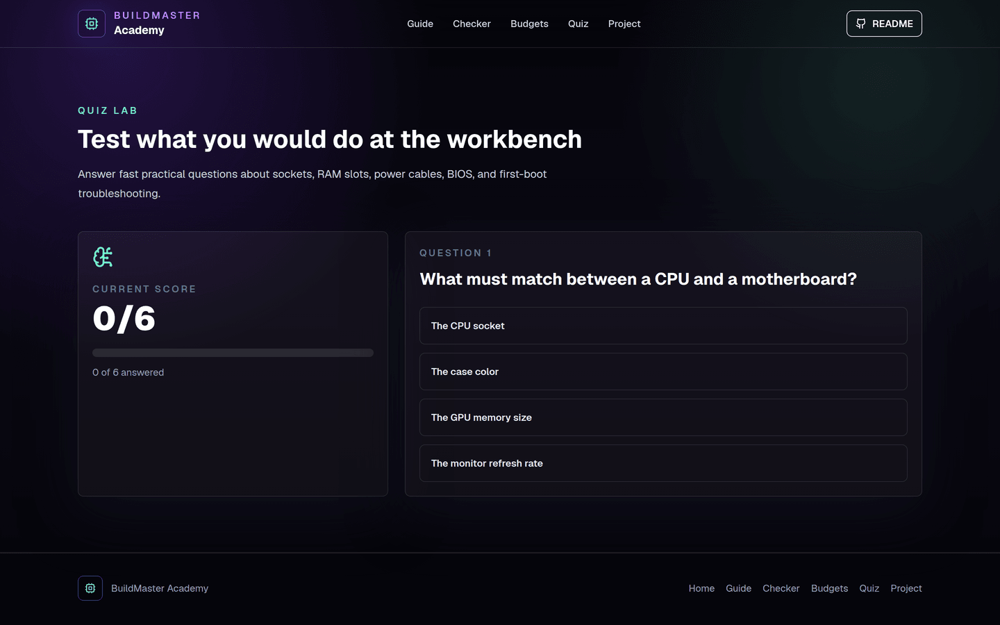
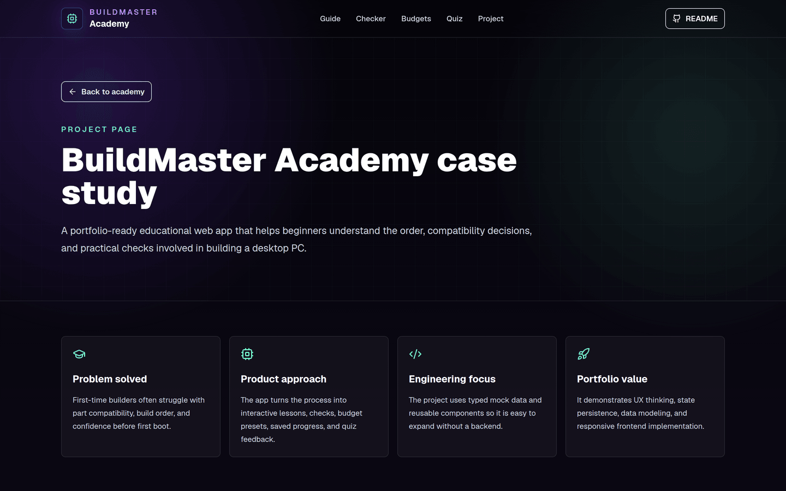
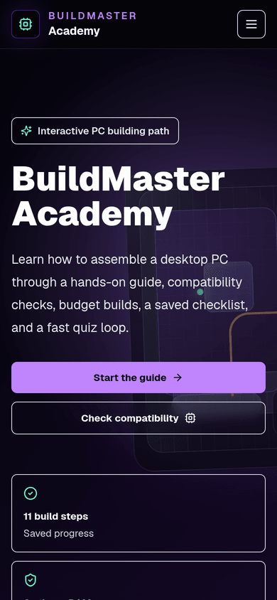
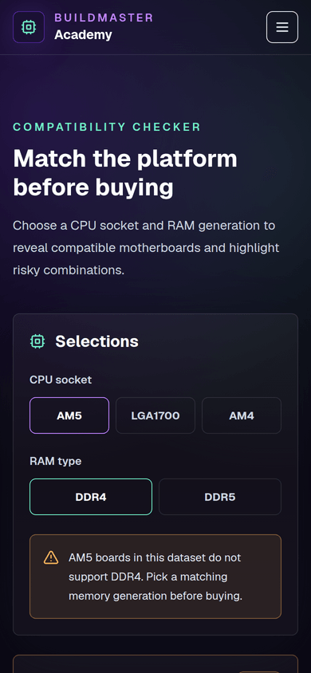

# BuildMaster Academy

BuildMaster Academy is a polished educational web app that teaches beginners how to build a desktop PC step by step. It combines a practical build guide, compatibility warnings, budget PC presets in PLN, saved checklist progress, and a short quiz about PC parts.

The project is built as a GitHub-ready portfolio application: no paid APIs, no backend requirement, typed local mock data, reusable React components, and a responsive dark UI.

## Zrzuty ekranu

Zrzuty są robione skryptem Playwrighta na zbudowanej wersji produkcyjnej
(`npm run build && npm run start`), nie rysowane ręcznie.

| | |
|---|---|
|  |  |
| **Strona główna** | **Przewodnik krok po kroku** |
|  |  |
| **Kompatybilność — AM5 + DDR4 z ostrzeżeniem** | **Zestawy budżetowe w PLN** |
|  |  |
| **Quiz** | **O projekcie** |

Widok mobilny (390 px):

| | |
|---|---|
|  |  |
| **Strona główna** | **Kompatybilność** |

Zrzut kompatybilności pokazuje celowo wybrane ostrzeżenie: dla gniazda AM5
i pamięci DDR4 żadna płyta z zestawu danych nie pasuje, więc aplikacja
wyświetla komunikat i oznacza wszystkie trzy płyty jako wymagające DDR5.

## Features

- Modern dark purple/black interface with a dashboard-like feel
- Landing page that explains the product and highlights the learning modules
- Step-by-step PC building guide covering:
  - Choosing parts
  - Preparing tools
  - Installing CPU
  - Installing RAM
  - Installing SSD
  - Mounting motherboard
  - Installing GPU
  - Connecting PSU cables
  - First boot
  - BIOS setup
  - Installing Windows/Linux
- Checklist system that saves completed build steps in `localStorage`
- Interactive compatibility checker for CPU socket, motherboard, and RAM type
- Budget PC builder with 2500 PLN, 4000 PLN, and 7000 PLN presets
- Multiple-choice quiz with scoring and explanations
- Project page with problem statement, technologies, learnings, and README-ready notes
- Local JSON mock data for guide content, budgets, compatibility, and quiz questions

## Tech Stack

- Next.js
- React
- TypeScript
- Tailwind CSS
- Lucide React icons
- Local JSON mock data
- Browser `localStorage`

## Getting Started

Use Node.js 24 (the same supported line as CI). Install the locked dependencies:

```bash
npm ci
```

Run the development server:

```bash
npm run dev
```

Open the local URL printed by Next.js, usually:

```text
http://localhost:3000
```

## Routes

Każde narzędzie ma własny adres — da się je podlinkować wprost, zamiast
wysyłać kogoś na stronę główną z prośbą o przewinięcie do sekcji:

| Adres | Zawartość |
|---|---|
| `/` | całość po kolei: hero, przewodnik, sprawdzarka, budżety, quiz |
| `/guide` | przewodnik krok po kroku |
| `/compatibility` | sprawdzarka kompatybilności płyty i pamięci |
| `/budgets` | gotowe zestawy w trzech przedziałach cenowych |
| `/quiz` | quiz wiedzy |
| `/project` | opis projektu |

Podstrony renderują **te same komponenty** co strona główna, więc nie ma
dwóch wersji tej samej treści do utrzymania. Strona główna zachowuje swoje
identyfikatory sekcji (`#guide`, `#checker`, `#budget`, `#quiz`), więc stare
odnośniki z kotwicami nadal działają.

## Testy i CI

```bash
npm run lint        # ESLint
npm run typecheck   # tsc --noEmit
npm test            # 16 testów
npm run build       # build produkcyjny
```

CI uruchamia wszystkie cztery plus audyt zależności na każdej gałęzi.

Testy pokrywają **sprawdzarkę kompatybilności** — to jedyne miejsce
w aplikacji, w którym zła odpowiedź kosztuje użytkownika pieniądze: ktoś
kupi płytę, która nie przyjmie jego pamięci.

Logika została w tym celu wyjęta z komponentu do `src/lib/compatibility.ts`,
żeby dało się ją sprawdzić bez renderowania Reacta. Najważniejszy test
dotyczy rozróżnienia, które łatwo przeoczyć: **„istnieją płyty dla tego
gniazda, ale żadna nie obsługuje tej pamięci" to co innego niż „dla tego
gniazda nie ma w bazie żadnej płyty"**. Pierwsze jest ostrzeżeniem dla
użytkownika, drugie luką w danych — i ostrzeżenie „te płyty nie obsługują
DDR4" przy zerowej liczbie płyt byłoby zwyczajnie nieprawdziwe.

Osobna grupa testów pilnuje spójności samych danych: każda płyta ma gniazdo
i pamięć z list wyświetlanych w interfejsie, identyfikatory są unikalne,
a każde gniazdo ma przynajmniej jedną płytę (gniazdo bez płyt to pusty ekran
po kliknięciu, a użytkownik nie wie, czy to błąd aplikacji, czy brak danych).

## Wdrożenie

`vercel.json` zawiera komendy budowania i nagłówki bezpieczeństwa. Aplikacja
jest w całości statyczna — wszystkie trasy są prerenderowane, nie ma
backendu ani zmiennych środowiskowych.

```bash
npx vercel --prod
```

## Historia repozytorium

Dwa pierwsze commity w tym repozytorium (`Build OrbitMentor Expo app`,
`Fix OrbitMentor web preview`) **nie dotyczą BuildMaster Academy** — to
pozostałość po innym projekcie, który powstawał w tym samym katalogu roboczym.

Historia nie została przepisana i nie zostanie. Wymagałoby to
force-pusha, czyli zmiany identyfikatorów commitów w opublikowanym
repozytorium; każdy, kto ma lokalną kopię, dostałby rozjechaną historię.
Cena jest wyraźnie wyższa niż zysk z kosmetyki.

Pliki OrbitMentora nie są w bieżącym stanie repozytorium — zostały
zastąpione przy commicie `Build BuildMaster Academy web app`. W `.gitignore`
zostały wpisy `.expo/`, które nic tu nie robią, ale też nic nie psują.

## Available Scripts

```bash
npm run dev         # serwer deweloperski
npm run build       # build produkcyjny
npm run start       # uruchomienie builda
npm run lint        # ESLint
npm run typecheck   # tsc --noEmit
npm test            # testy (vitest)
```

## Project Structure

```text
app/
  globals.css
  layout.tsx
  page.tsx
  project/
    page.tsx
src/
  components/
    AppHeader.tsx
    BudgetBuilder.tsx
    BuildGuide.tsx
    CompatibilityChecker.tsx
    FeatureGrid.tsx
    Footer.tsx
    HeroWorkbench.tsx
    HomeExperience.tsx
    ProjectTeaser.tsx
    Quiz.tsx
    SectionHeader.tsx
  data/
    budgetBuilds.json
    compatibility.json
    guideSteps.json
    quizQuestions.json
  lib/
    utils.ts
  types/
    buildmaster.ts
```

## Mock Data

All content is stored locally:

- `src/data/guideSteps.json` stores the ordered PC build lessons
- `src/data/compatibility.json` stores CPU sockets, RAM types, and motherboard examples
- `src/data/budgetBuilds.json` stores suggested part lists for each PLN budget
- `src/data/quizQuestions.json` stores multiple-choice quiz questions

## What I Learned

- How to structure an educational flow around a real-world technical task
- How to model compatibility rules in simple local data
- How to persist checklist progress with browser storage
- How to build responsive interactive sections with reusable React components
- How to present a full-stack-style portfolio project without relying on paid APIs

## Future Improvements

- Add searchable part catalogs and deeper compatibility rules
- Add printable/exportable build checklists
- Add user-created build plans with editable part lists
- Add accessibility preference controls for motion and contrast
- Add more quizzes and spaced repetition
- Add deployment screenshots and a live demo link after hosting

## Licencja

MIT — patrz [LICENSE](LICENSE).

## Reproducible builds and validation

The UI uses the operating system's sans-serif font stack. No Google Fonts
request is needed during build or at runtime. This keeps the existing layout
and avoids a network prerequisite for typography; the exact font varies by OS.

Run `npm ci`, `npm run lint`, `npm run typecheck`, `npm test`,
`npm run build`, then `npm start`. The production server was exercised in
Chromium at a 390px viewport: checklist persistence after reload, incompatible
and compatible RAM/socket choices, a complete quiz and restart. Font hosts
were blocked in that browser test and no font requests occurred.

The content is a local educational dataset, not a live inventory or pricing
feed. Checklist data stays in the browser. No account or backend is required.
Local production startup is verified; deployment to a hosting provider and
its rollback remain unverified. To roll back a release, redeploy the previous
Git revision and its lockfile, retaining browser data with the existing key.


### Testy przeglądarkowe

Po zainstalowaniu zależności aplikacji i zbudowaniu frontendu zgodnie z README / workflow `browser.yml` (lub jobem browser w `ci.yml`):

```bash
python -m venv .venv-e2e
# Aktywuj ten venv przed dalszymi poleceniami.
python -m pip install -r e2e/requirements.txt
python -m playwright install chromium
python -m pytest -q e2e
```

Na Linux może być potrzebne `python -m playwright install --with-deps chromium` z uprawnieniami administratora. Alternatywnie `PLAYWRIGHT_CHROMIUM_EXECUTABLE_PATH` wskazuje istniejący Chromium. Testy uruchamiają i zatrzymują własny serwer, używają nowego kontekstu przeglądarki i zapisują logi w ignorowanym `e2e/artifacts/`. Pełny backend musi mieć zainstalowane swoje zależności; `E2E_API_PYTHON` jest opcjonalnym wyborem jego interpretera w AutoDesk/BankGuard. Testy nie uruchamiają wdrożenia.

## Aktualizacja zależności 2026-10-17

Lockfile używa Next.js 16.4.2 i sharp 0.35.5 po naprawie zgłoszeń audytu. Lint, typy, 16 testów, produkcyjny build i scenariusz Chromium ponownie przeszły. Pozostałe zgłoszenia npm dotyczą głównie narzędzi Tailwind/ESLint; pełna bramka `npm audit --audit-level=high` nadal wymaga ich rozwiązania. Publiczne wdrożenie nie zostało wykonane.

## Walidacja etapu 2 — 2026-10-18

Czysta instalacja, lint, typy, 16 testów, produkcyjny build/start i E2E checklist/kompatybilności/quizu/persistencji przechodzą. Skan axe na `/`, `/guide`, `/compatibility` i `/quiz` przy szerokości 390 px nie wykazał naruszeń sprawdzanych reguł WCAG 2 A/AA i 2.1 AA. Nie jest to pełna certyfikacja dostępności.

CI używa `npm run security:check`: pełny audit oraz weryfikacja wersjonowanej poprawki braces i regresji ataków. Surowy audit nadal zgłasza tę zależność. Szczegóły, ograniczenia i obowiązkowy przegląd do 2026-11-18: [SECURITY_PATCH.md](SECURITY_PATCH.md). Lokalny przebieg nie oznacza wykonania GitHub Actions ani publicznego wdrożenia.
