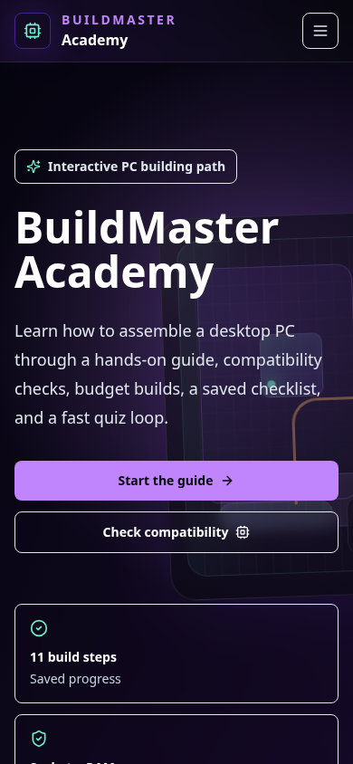
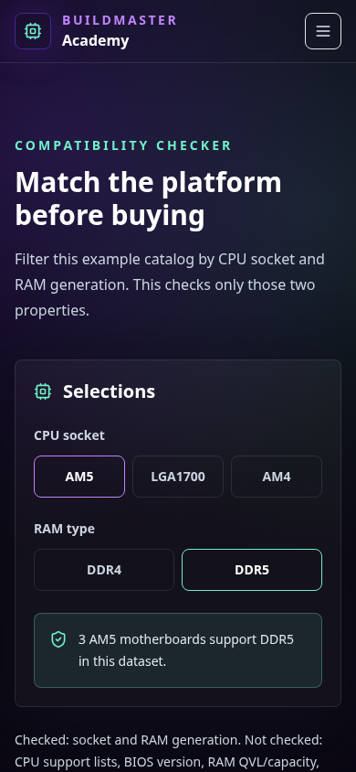

# BuildMaster Academy

BuildMaster Academy is a small educational app for learning the order of a PC build. It combines a guided checklist, a limited motherboard filter, example budget allocations, and a short quiz. It uses local JSON data and browser storage; it does not connect to retailer, manufacturer, or compatibility APIs.

## Run it locally

```bash
npm install
npm run dev
```

Open the local address printed by Next.js. The home page is a short introduction; each tool has its own route.

| Route | Demo |
|---|---|
| `/` | Start page and links to the learning tools |
| `/guide` | PC build steps and saved checklist |
| `/compatibility` | Filter the sample board data by CPU socket and RAM type |
| `/budgets` | Example part allocations in PLN |
| `/quiz` | Multiple-choice PC building quiz |
| `/project` | Project notes and limitations |




These images are captured from the production app by the Playwright suite at a 390 px viewport.

## Data limits

Budget amounts are educational estimates, not current retailer quotes. Some components are generic categories rather than tested product models. The compatibility tool checks only socket and memory generation; it does not verify CPU support lists, BIOS versions, memory capacity, case clearance, cooling, power requirements, or storage lanes. Confirm exact parts with their manufacturers before buying.

Checklist progress is versioned in `localStorage`. Old or unknown step IDs are removed from the visible progress, duplicate entries do not inflate completion, and failed writes keep progress in the current tab with a retry message. Clearing browser data clears saved progress.

## Quality checks

```bash
npm run lint
npm run typecheck
npm test
npm run build
```

Vitest covers the compatibility rules and catalog consistency. The Playwright suite checks checklist persistence and quota recovery, compatibility results, the quiz, mobile overflow, and that the app does not depend on Google Fonts.

```bash
python -m venv .venv-e2e
. .venv-e2e/bin/activate
python -m pip install -r e2e/requirements.txt
python -m playwright install chromium
python -m pytest -q e2e
```

Set `PLAYWRIGHT_CHROMIUM_EXECUTABLE_PATH` if Chromium is installed outside Playwright's browser directory.

## Stack and scope

Next.js, React, TypeScript, Tailwind CSS, Lucide icons, local JSON, and `localStorage`. There is no account, server, or retailer feed. The repository contains hosting configuration, but no public deployment is verified here.
